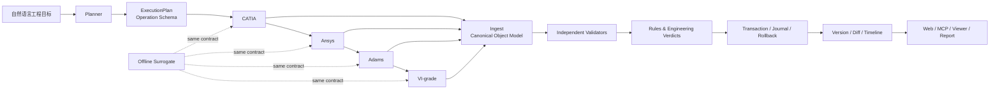

<div align="center">

# SimLoom AI

### 面向车辆与机械研发的跨软件 AI Engineering Agent Runtime

把自然语言工程目标，连接到 CATIA、Ansys、Adams 和 VI-grade 的模型、脚本、
结果、验证与版本历史。

[快速开始](#快速开始) · [离线四软件闭环](#离线四软件闭环) · [能力地图](#能力地图) · [项目定位](#项目定位)

工程化路线见 [`docs/PRODUCT_ENGINEERING_ROADMAP.md`](docs/PRODUCT_ENGINEERING_ROADMAP.md)。

</div>

<div align="center">


</div>

SimLoom AI 是一个以操作工程软件为核心的 AI Agent 原型，面向车辆、底盘、悬架、机构和
机械零件研发。它把四个软件之间容易丢失的上下文统一起来：同一份工程对象、
同一套事务边界、同一套验证规则、同一条版本与审计链。

项目地址：[github.com/MODA255/MODA255-SimLoom-AI](https://github.com/MODA255/MODA255-SimLoom-AI)

## 项目定位

SimLoom AI 的核心不是替代某一个 CAD 或仿真软件，而是成为连接工程工具的
AI runtime：

```text
自然语言工程目标
        ↓
AI 任务规划与 operation schema
        ↓
CATIA → Ansys → Adams → VI-grade
        ↓
模型、脚本、STEP、CSV、JSON、结果文件
        ↓
独立几何/结果验证、指标判断、版本 diff、可视化和审计
```

当前开发主线是可靠地操作 CATIA、Ansys、Adams 和 VI-grade：理解工程目标、调用软件、
回收结果并检查是否满足要求。本地 CAD、OpenCascade、Viewer 和离线演示用于输入准备、
预览、独立检查与流程测试；不以重做建模器或求解器为主线。

产品边界、四款软件与 SimLoom 各自负责的部分，见
[`docs/PRODUCT_POSITIONING.md`](docs/PRODUCT_POSITIONING.md)。实际使用时，四款软件仍是
原生几何、网格、求解和专业结果的权威系统；SimLoom 负责控制、传递、观察、验证和追溯。

软件操作采用显式动作和脚本绑定、本机或远程 worker、独立运行目录、输入/输出哈希校验，
以及同一次事务中的结果和历史发布。远程任务支持持久编号、断线查询、日志、取消、
同软件排队及原任务结果回收；工作台的环境检查页提供操作入口。仅退出成功、配置了路径或连通了 COM 都不代表
工程任务成功。目前完成的是执行链路的测试，四款商业软件的实机操作仍未验收。
自动生成的脚本是待完善模板，不会自动绑定为可执行功能。

CAD 辅助脚本也遵循同一条边界：`cad.script_apply` 默认关闭，显式开启后脚本只处理事务
工作目录中的 DXF 副本，输出文件经过静态策略检查、时限和大小限制、重新读取验证、diff、
checkpoint 和跨会话撤销。它用于准备输入和批量辅助编辑；真正的 CATIA、Ansys、Adams、
VI-grade 建模与求解仍由对应软件完成。

内置软件入口现在提供参数/结果证据契约：CATIA 保存后重新开盘读回，Mechanical 严格检查完成与求值状态；Adams/VI-grade 对已配置的导出命令重读 JSON/CSV，并核对单位及阈值。执行成功与工程指标合格分别记录。通用导出接口不代表所有厂商原生格式或产品版本已接入。

接入配置与限制见 [软件操作与 Windows worker](docs/SOFTWARE_INTEGRATION.md)。

真正启动软件前，可以先运行 `preflight` 检查动作绑定、项目内 runner、启动命令和输出契约：

```bash
PYTHONPATH=src python -m engineering_agent.cli \
  --config configs/my-engineering-agent.json \
  --project-dir ./demo preflight \
  "CATIA建模，Ansys应力分析，Adams动力学，VI-grade操稳"
```

这一步只检查启动条件；它不会启动商业软件，也不把连接成功当成许可证、求解收敛或工程指标
合格。Web 的 `POST /api/preflight` 和 MCP 的 `engineering_preflight` 提供相同检查。

## 能解决什么问题

- 把一个车辆或机械研发目标拆成有依赖关系的 CATIA、Ansys、Adams、VI-grade 任务。
- 从一份 vendor-neutral `ModelSpec` 生成四个软件各自需要的输入和脚本模板。
- 将 STEP、CSV、JSON、DXF、OBJ、VTK、VTU、GLB、SVG、PDF 统一读入工程对象模型。
- 在结果交付前独立检查几何、网格、指标、文件完整性和规则阈值。
- 独立检查 CAD 的文字高度、闭合轮廓退化、重复几何和尺寸关联要求。
- 查询内置 ISO/ASME 图形能力目录，并对需要严格目录校验的符号和紧固件输入给出明确错误；最终标准合规仍由原生 CAD 软件确认。
- 通过标准库查询 P&ID 符号、GD&T 特征、紧固件、轴承和孔型，并审计图纸中已经放置的标准部件。
- 将带语义标签的 P&ID 符号和过程线读回为连接图，检查孤立设备和必需连接。
- 创建正交 P&ID 路线，并可在已有过程线上切断插入阀门；阀门、上下游连接段、服务属性和原始管线关系会一起进入事务、DXF 和审计结果。
- 用事务 staging、锁、journal、checkpoint、commit 和 rollback 管理写操作。
- 创建不可变工程快照，比较版本差异，并生成项目时间线。
- 对两个 DXF 版本生成实体级视觉 diff，直接看出新增、删除和修改的几何。
- 对已保存的工程快照直接生成 DXF 视觉 diff，保留版本时间线和对象级差异。
- 为 CATIA/Ansys/Adams/VI-grade 的结果文件建立可恢复监测游标，识别新增、修改、删除、仅时间戳变化和仍在写入的文件，见 [外部工程文件监测](docs/FILE_WATCH.md)。
- 在软件任务启动前生成保守的工程依赖图，标出项目内引用、配套文件、缺失目标和外部目标，见 [工程依赖扫描](docs/DEPENDENCY_SCAN.md)。
- CAD 修剪会对有限直线、圆、圆弧和直线多段线边界求真实交点，并在事务提交后重新验证，见 [修剪边界契约](docs/CAD_TRIM.md)。
- 通过 CLI、Web API、MCP 或 Python API 使用同一套 runtime。

这里的“生成脚本”和“调用软件”指的是给已安装的软件准备输入并驱动其执行。生成模板、
离线 fixture 和本地 viewer 都不会被当成 CATIA、Ansys、Adams 或 VI-grade 的真实建模器、
求解器或结果后处理器。

## 能力地图

| 能力 | 当前实现 | 说明 |
| --- | --- | --- |
| AI 规划 | ✅ | 确定性 planner；支持 OpenAI 兼容接口的可选 LLM planner |
| 统一工程对象 | ✅ | 项目、几何、结果、表格、指标和 artifact 归一化；CAD 查询返回稳定 `EntityRef` |
| CATIA / Ansys / Adams / VI-grade 脚本生成 | ✅ | 生成可审计的 CATScript、Mechanical Python、Adams command 和 VI-grade scenario 模板 |
| 离线四软件闭环 | ✅ | 无商业软件时生成本地 fixture（STEP、CSV、JSON）并验证 SimLoom 的流程和规则 |
| STEP 读取 | ✅ | 保守实体解析；安装 OCP 后启用真实 B-Rep 检查 |
| B-Rep 几何 | ✅ 可选 | box/cylinder/sphere/cone、fuse、cut、common、体积、表面积、拓扑和包围盒 |
| DXF / OBJ / VTK / VTU / GLB | ✅ | 语义实体、图层、块、填充、坐标系、网格读取、显示网格导出与独立校验 |
| 结果解析 | ✅ | JSON、CSV 和文本结果；支持指标路径和阈值判断 |
| 事务与恢复 | ✅ | staging、锁、journal、checkpoint、commit、rollback、stale recovery |
| 版本与 diff | ✅ | 不可变快照、字段级差异、资产路径匹配和时间线 |
| Viewer | ✅ | DXF 选择、高亮、图层开关、直接编辑和跨会话撤销/重做；自包含 WebGL 网格/结果云图 viewer |
| MCP | ✅ 基础闭环 | tools、resources、prompts、分页、schema/error envelope；资产预览可返回结构化数据和 SVG image content；写操作后支持 resource update notification |
| Web 控制台 | ✅ | 规划、任务队列、项目、artifact、资产预览和时间线 API |

### 2D CAD 编辑层

DXF 现在可以通过统一的 `CadDocument` 编辑层处理。文档包含稳定的
`EntityRef`、`SelectionSet`、`Layer`、`Block`、`Constraint` 和操作历史；所有
`cad.*` 写操作都经过同一个事务、checkpoint、独立验证、自动修复、diff 和
rollback 路径，并在提交后重新读取 DXF 做落盘验证。当前提供实体创建/更新/删除、
移动/复制/旋转/缩放/镜像、矩形/极坐标阵列、break/join/purge、trim、offset、
fillet/chamfer、break/join、explode/reverse/purge、图层、选择集、块、坐标系、sheet、
viewport、title block、hatch、线性/径向/角度/坐标 dimension、leader、MTEXT、ellipse、table、constraint、audit、diff 和
原子 batch operation。当前注册表包含绘图、编辑、检查和持久历史等 `cad.*` operation；DXF 旁边会生成 `.cad.json` 元数据文件，保留
选择集、约束等应用上下文。新建实体的稳定 ID 同时写入 DXF 的应用数据；已有实体继续使用原生 handle，外部重排不会按数组顺序重新分配 ID。

DXF 读写使用 `ezdxf`，在原图纸上更新实体，保留未编辑对象的 handle、外部应用数据、扩展字典、样式、块属性和纸空间。原生标注含定义点和实际图形块；填充可以保留多个边界、孔洞与圆弧/样条边界。保存后会直接读取 DXF 做原生结构审计，并核对实体几何、标注测量值和视口。发现写入丢失或需要结构修复时，事务恢复原文件及历史。

只读 `cad.query` 可以按实体类型、图层、选择集、块名、布局、属性、文字内容、闭合状态、约束引用、
数值范围和空间窗口筛选实体，并支持分页和仅返回元数据。每个结果都带有稳定的 `EntityRef`，因此上层 Agent
可以先查询，再把同一引用交给编辑、验证或 Viewer 高亮流程，而不依赖 DXF 数组顺序。
Viewer 的“查询并高亮”输入框会通过同一 `cad.query` operation 查询当前图纸，并自动选择和缩放
当前页返回的实体；分页结果仍显示完整命中数。

只读 `cad.verify_dimensions` 会按稳定实体引用重新计算线性、径向、直径和坐标尺寸的物理值，
并可同时检查标注显示文字。它返回目标值、实际值、容差边界、显示值和错误列表，不写入 DXF，
适合在 CAD 写事务提交后作为独立尺寸验收步骤。

```python
agent.execute_operation("cad.query", {
    "project_dir": "./project",
    "input_file": "./project/drawing.dxf",
    "entity_type": "CIRCLE",
    "layer": "HOLES",
    "window": [{"x": 0, "y": 0}, {"x": 100, "y": 100}],
    "include_geometry": False,
})
```

```python
agent.execute_operation("cad.verify_dimensions", {
    "project_dir": "./project",
    "input_file": "./project/drawing.dxf",
    "checks": [{"entity_id": "e00001", "value": 50.0, "tolerance": 0.01, "check_display": True}],
})
```

机械装配图工作流 `cad.draw_mechanical_assembly` 可以从结构化零件规格生成前视、端视和剖视图，
并同时写入孔阵列、尺寸、BOM、序号气泡和语义元数据。提交后会重新读取 DXF，核对零件、孔和尺寸
记录；它用于工程图准备与审计，不替代 CATIA 的真实零件特征或装配约束。

P&ID 工作流 `cad.draw_pid` 可以从设备、阀门、仪表、连接器和 `设备.端口` 连接关系生成带语义
的流程线，并在提交前后重建端口图检查孤立设备、悬空连接和重复管线编号。流程线、端口和编号会
随 DXF 元数据保存，适合在 Windows 上交给 CATIA 或其他厂商后端继续编辑。

自动化测试覆盖独立库生成的复杂图纸、二进制输入、R12 多段线、自定义填充、嵌套块、SPLINE 和失效元数据。SPLINE 支持创建、原生读回和几何变换；关联 HATCH 在移动或旋转时会自动带上引用的边界实体，并由事务提交后的原生回读再次检查关联句柄。复杂曲线编辑、关联边界重构和厂商专有实体仍会明确拒绝。早期无版本头、含不透明记录的文件使用兼容写入路径，并报告无法执行原生审计；完整 DXF 解析失败时不会悄悄降级。详见 [DXF 读写与验证](docs/NATIVE_DXF.md)。

```python
agent.execute_operation("cad.batch_apply", {
    "project_dir": "./project",
    "input_file": "./project/part.dxf",
    "output_file": "./project/part-edited.dxf",
    "operations": [
        {"operation": "cad.layer_create", "name": "ANNOTATION", "color": "#b35c00"},
        {"operation": "cad.entity_move", "entity_ids": ["e00001"], "delta": [10, 0, 0]},
        {"operation": "cad.dimension_create", "definition": {"x": 10, "y": 4}, "measurement": 42.0},
    ],
})
```

验证发现零长度线、非法半径、短多段线、无效填充边界或缺失块引用时，
`cad.validate_and_repair` 会生成可审计的修复 operation plan，并在验证通过后
再提交结果。Web 资产预览对 DXF 提供实体选择、图层开关、变更对象定位、真实历史快照回放、撤销/重做和选择集保存。Viewer 的移动、旋转、删除、文字属性编辑和选择集保存会通过父工作台的 `postMessage` 发回
`/api/cad/operation`，因此和 Python/MCP 一样经过事务、checkpoint、独立验证、diff、落盘重读和 rollback；外部 CAD
软件仍然只负责后续的厂商格式和真实求解。

CAD 审计也可以带工程要求，例如 `required_layers`、`required_entity_types`、
`required_text`、`required_sheets`、`required_viewports`、实体数量和包围盒约束；
这些要求会同时检查事务暂存文档和提交后重新读取的实际文件。

建筑平面任务可以使用 `cad.draw_arch_plan`：输入轴对齐的墙体中心线、厚度、门窗开口和房间
位置，系统会在同一事务中生成墙体边界、开口标记、房间面积标签和尺寸，并在 DXF 重新读取后
核对面积。当前实现明确限制为轴对齐闭合墙环；内部岛、复杂弧墙和厂商建筑对象仍应交给原生
软件或后续专用 runner。


圆角/倒角支持同一 XY 平面内的两条相连直线，圆角按真实切点修剪并生成内部短弧。
构造后和 DXF 落盘后均检查连接、相切与目标尺寸；不支持的选择或几何会明确拒绝。
具体参数、批次语义和验证范围见 [圆角与倒角契约](docs/CAD_CORNERS.md)。

### 原生二维几何视图

工作台的 DXF 预览显示原生圆弧、带凸度的多段线、旋转椭圆、嵌套块与属性、
填充孔洞及尺寸标注。点击块内图形仍选择顶层可编辑实体；滚轮缩放、拖动平移、
Shift 框选和图层显示开关可直接使用。事务编辑完成后保留世界坐标视角与选择。

「图纸版本」可以查看初始图纸及每次已保存的修改，支持前后步、播放和暂停。
回放读取经过哈希校验的 DXF 与元数据快照，可以看到移动前的位置和后来删除的对象，
不会执行编辑命令或移动撤销位置。历史模式禁止编辑和出图；「返回当前」重新读取当前文件。
批次按一次原子提交回放，子步骤的对象列表用于高亮定位，不提供批次内部的几何快照。

暂不支持的图元和缺字会显示提示，预览本身不修改原图。
详见 [原生二维 CAD 视图](docs/NATIVE_CAD_VIEWER.md)。当前模型视图、纸空间出图、
历史版本查看是不同能力；尚未完成的目标记录在 [AgentCAD 对齐清单](docs/AGENTCAD_PARITY.md)。

### 工程图纸与出图

在工作台打开 DXF 后，展开「图纸与出图」，即可创建 A4～A0 图纸、填写图号与版本，
保存原生块属性标题栏，并导出支持多页的矢量 PDF、单页 SVG 或 PNG。出图预览包含实际标注、
填充孔洞和纸空间视口。模型空间可按指定比例出图；放不下会明确报错。

标题栏修改可撤销/重做。导出文件与出图记录成组提交，失败恢复前一版本，
不修改源 DXF。出图记录包含纸张、比例、源文件哈希和渲染提示。

```bash
python examples/cad_sheet.py --output ./cad-sheet-example
```

示例生成带四个通孔与尺寸标注的安装板、可编辑 A3 图纸及 PDF/PNG。
详见 [图纸与出图使用说明](docs/DRAWING_EXPORT.md)。当前提供通用标题栏模板和
二维出图；企业制图标准、中文/SHX 字体、打印样式与客户图纸兼容仍需验收。

### 跨会话撤销与重做

新的 CAD 修改会同时保存 DXF、`.cad.json` 和持久历史。关闭程序后仍可撤销与重做；
工作台预览中也提供两个按钮。命令行入口如下：

```bash
python -m engineering_agent.cli --project-dir ./project cad-history part.dxf
python -m engineering_agent.cli --project-dir ./project cad-undo part.dxf
python -m engineering_agent.cli --project-dir ./project cad-redo part.dxf
```

修改前读取、文件替换和落盘验证共用同一把项目锁。验证失败会恢复原文件；
进程在提交中途退出后，下次操作会先按日志恢复。撤销会检查当前文件的哈希，
遇到外部软件修改或备份损坏时拒绝覆盖。撤销后继续编辑会形成新的历史分支，
替换尚未重做的分支。旧版本产生、没有历史记录的修改不能追溯撤销。

文件组通过日志恢复一致性；单个文件使用原子替换。外部软件不参与项目锁，
因此不能保证它在提交过程中读取多个文件时获得同一版本。
详细契约与测试入口见 [CAD 修改、恢复与历史](docs/CAD_RELIABILITY.md)。

## 架构



所有外部入口最终进入同一套 agent API：

```text
CLI ─┐
Web ─┼─> EngineeringAgent ─> OperationRegistry ─> adapters / validators
MCP ─┘                                      └──> transaction + audit
```

## 快速开始

### 1. 安装

```bash
git clone https://github.com/MODA255/MODA255-SimLoom-AI.git
cd MODA255-SimLoom-AI

./install.sh
. .venv/bin/activate
```

最方便的入口是本地工程工作台：

```bash
PYTHONPATH=src python -m engineering_agent.cli desktop --mode browser
```

它会启动一个本地地址并打开浏览器。工作台也支持可选的独立桌面窗口：

```bash
python -m pip install -e '.[desktop]'
PYTHONPATH=src python -m engineering_agent.cli desktop --mode native
```

Windows 用户可以直接运行 `install-windows.cmd`，安装完成后双击 `Start SimLoom AI.cmd`。
macOS/Linux 可以执行 `./Start SimLoom AI.command`（先运行 `./install.sh`）。项目、队列
和历史记录默认保存在操作系统的用户数据目录，不会把运行数据库写进源码目录。

项目不要求先安装 CATIA、Ansys、Adams 或 VI-grade。离线 runtime、解析器、验证器、
事务层、MCP 和测试都可以在普通开发环境运行。

### 2. 生成计划

```bash
PYTHONPATH=src python -m engineering_agent.cli plan \
  "用 CATIA 建悬架模型，导入 Adams 做动力学，再用 VI-grade 做操稳分析"
```

### 3. 生成四软件输入

```bash
PYTHONPATH=src python -m engineering_agent.cli \
  --project-dir ./examples/demo_project generate \
  --name suspension_demo
```

生成内容包括：

```text
artifacts/generated/
├── model_spec.json
├── catia/create_model.CATScript
├── ansys/solve.py
├── adams/build_model.cmd
├── vi-grade/scenario.json
├── vi-grade/run_scenario.py
└── README.md
```

### 4. 检查工程资产和指标

```bash
PYTHONPATH=src python -m engineering_agent.cli \
  inspect --root examples/demo_project

PYTHONPATH=src python -m engineering_agent.cli \
  evaluate examples/demo_project/metrics.json \
  examples/demo_project/rules.json
```

## 第一次使用工作台

打开工作台后按这条路径操作：

1. 点击“新建项目”，填写项目名称并选择“悬架结构”“悬架动力学”“整车操稳”或“四软件离线体验”。
2. 在第二步调整轴距、轮距、几何高度和载荷；这些参数会写入项目的 `simloom.project.json`。
3. 用自然语言描述目标，点击“生成工程计划”查看阶段和依赖关系。
4. 点击“运行离线闭环”生成 STEP、CSV、JSON 和报告；任务状态会自动记录。
5. 进入“模型与结果”，点击文件即可查看 STEP 包围盒或 B-Rep 曲面网格、OBJ/VTK/VTU/GLB 网格、CSV 曲线和 JSON 指标。

项目向导会为每个新项目创建独立目录；重复使用同一个目录会被拒绝，以避免覆盖已有工程。

## 离线四软件闭环

离线闭环用于验证整个工程 runtime 的行为，不要求商业软件安装。它会依次生成：

1. CATIA 阶段：真实本地 STEP 几何。
2. Ansys 阶段：结构结果 JSON，包括应力、位移和网格质量。
3. Adams 阶段：运动 CSV，包括时间、转向、横摆角速度和侧向加速度。
4. VI-grade 阶段：车辆指标 JSON，包括横摆增益、转向不足梯度和圈速。

运行示例：

```bash
PYTHONPATH=src python -m engineering_agent.cli \
  --project-dir ./examples/offline_demo offline-run \
  --model-spec "$(cat examples/offline_demo/model_spec.json)" \
  --rules examples/offline_demo/rules.json
```

成功后，产物位于：

```text
examples/offline_demo/artifacts/generated/
├── offline/model.step
├── offline/ansys_result.json
├── offline/adams_motion.csv
├── offline/vigrade_metrics.json
└── offline/report.json
```

报告会把 Ansys 和 VI-grade 指标合并后交给独立规则验证器。每个产物都会记录
文件大小和 SHA-256，整个过程经过事务 staging 后一次性提交。

离线阶段是确定性的工程 surrogate，用来验证对象、文件、事务、规则和审计边界。
它不代表 CATIA、Ansys、Adams 或 VI-grade 的真实求解结果；接入 Windows bridge 后，
可以保持报告和验证接口不变，替换相应 stage。

## OpenCascade / STEP B-Rep

安装可选 B-Rep 后端：

```bash
./.venv/bin/python -m pip install -e '.[brep]'
```

可用时，runtime 可以读取 STEP solid，计算体积和表面积，检查拓扑，创建 box/cylinder，
并执行 `fuse`、`cut`、`common`：

```bash
PYTHONPATH=src python -m engineering_agent.cli brep-doctor

PYTHONPATH=src python -m engineering_agent.cli \
  --project-dir ./examples/demo_project \
  brep-primitive box artifacts/box.step \
  --parameters '{"length": 100, "width": 50, "height": 20}'

PYTHONPATH=src python -m engineering_agent.cli \
  brep-inspect artifacts/box.step
```

没有 B-Rep 依赖时，系统会明确返回后端不可用，并保留保守 STEP 实体解析能力。

除单个 primitive 和布尔操作外，`brep.build_feature_graph` 可以按参数和约束重建
box、cylinder、sphere、cone 以及 fuse/cut/common 特征，并生成同名 `.brep.json` 历史文件。

三个 B-Rep 写操作都会把输入和输出限制在项目目录内，并在事务提交前后各检查一次 STEP：
第一次检查内核写出的 staging 文件，第二次从实际目标文件重新读取，确认形状有效、拓扑非空、
体积有限且非负。第二次检查失败会自动恢复旧文件，结果会同时进入事务 journal 和 operation
返回值；当 primitive 或 boolean 覆盖同一路径时，旧的 `.brep.json` feature graph sidecar
会被清理。这样本地 OpenCascade 可以作为可靠的输入准备和审查后端，但仍不会被当作四款商业
软件的替代品或实机验收证据。

## Web 控制台与任务队列

启动本地 Web 控制台：

```bash
PYTHONPATH=src python -m engineering_agent.cli serve --port 8787
```

打开 `http://127.0.0.1:8787` 后，可以生成计划、提交任务并查看任务状态。主要接口包括：

现在的首页已经按工程工作台组织：左侧是工程导航，中间是任务输入和 CATIA →
Ansys → Adams → VI-grade 流程画布，右侧区域展示验证指标、任务时间线、资产
扫描和工具诊断。模板卡片可以直接开始悬架结构、悬架动力学、整车操稳或自定义流程。
“运行离线闭环”按钮会调用同一套 runtime，适合第一次试用和没有商业软件的机器。

| 方法 | 路径 | 用途 |
| --- | --- | --- |
| `GET` | `/api/health` | 健康检查 |
| `POST` | `/api/plan` | 生成并校验计划 |
| `GET/POST` | `/api/tasks` | 查询或提交任务 |
| `GET/POST` | `/api/projects` | 管理历史项目 |
| `GET` | `/api/artifacts` | 列出工程产物 |
| `GET` | `/api/asset-view` | 获取 SVG/WebGL 资产预览 |
| `GET` | `/api/cad/history-view` | 按 `root`、`path`、`revision_id`、`side=before/after` 只读查看已校验的 DXF 历史快照 |
| `POST` | `/api/cad/operation` | 执行统一 `cad.*` 文档操作、原子 batch、自动修复和 Viewer 编辑 |
| `GET` | `/api/timeline` | 获取版本时间线 |
| `GET` | `/api/versions?project_id=...` | 获取项目版本摘要、DXF 能力标记和时间线 SVG |
| `POST` | `/api/version` | 从当前项目资产创建不可变版本快照 |
| `GET` | `/api/version-file` | 校验并下载历史版本中的原始文件 |
| `POST` | `/api/version-export` | 将完整历史文件组导出到新的项目子文件夹 |
| `POST` | `/api/version-visual-diff` | 比较两个项目快照，返回实体统计、语义 diff 和 SVG 叠加图 |
| `GET` | `/api/doctor` | 检查工具配置 |
| `GET` | `/api/capabilities` | 返回离线、排练、Windows 连接和真实执行的能力矩阵 |

工作台也提供 `GET /api/templates` 和 `POST /api/offline-run`，方便桌面壳或其他
前端复用模板与离线执行能力。

工作台项目服务还提供：

- `POST /api/projects`：创建带模板、参数、目录和默认规则的工程项目。
- `GET /api/projects/<id>`：重新打开历史项目。
- `POST /api/tasks/<id>/run`：运行一次排练任务；排练只生成输入并执行 dry-run。
- `GET /api/download`：下载原始工程文件。

工程文件预览在安全的 iframe 中运行，避免模型/结果中的 HTML 或脚本影响工作台页面。
STEP 有 OpenCascade 时会先三角化真实 B-Rep 曲面，然后自动居中、适配尺寸并支持旋转、
缩放、重置和线框切换；`brep.tessellate_step` 可以把同一份显示网格事务化导出为 OBJ 或 GLB。
没有内核时会明确显示包围盒预览。CSV 预览最多绘制前四个数值列，
大文件会抽样显示并保留完整原始文件下载。

项目历史页会加载版本快照和时间线。选择两个包含 DXF 几何的版本后，工作台会显示新增、
删除、修改和未变化实体的统计，并把语义 diff 与 SVG 叠加图放在同一个对比卡片中。版本接口
只返回摘要，完整快照仍由服务端按项目目录读取，避免把大型几何一次性传给浏览器。
也可以直接在历史页保存当前项目版本；新版本同时保存原始文件、SHA-256 和解析后的对象，
自动附带 CAD/B-Rep/出图元数据。历史预览、下载和导出读取保存的原件；当前文件被覆盖或
删除后仍可使用。旧版本会标明仅有解析摘要，完整文件组可导出到新的项目子文件夹。
原生厂商格式的文件保存不等于软件验收；外部装配依赖需要显式纳入。
详见 [工程原始文件版本](docs/PROJECT_VERSION_FILES.md)。

也可以使用 SQLite 任务队列：

```bash
PYTHONPATH=src python -m engineering_agent.cli enqueue \
  --db engineering-agent.db \
  "用 CATIA 建悬架并做 Adams 动力学"

PYTHONPATH=src python -m engineering_agent.cli worker \
  --db engineering-agent.db --once
```

### 任务详情、失败重试与报告交付

运行离线闭环后会自动进入任务详情页；也可从任务历史点击「查看详情」。
详情页展示每个阶段的状态和实际耗时、当次输入与规则、执行计划、指标判定、
产物下载和事件时间线。运行中的记录会自动刷新。

点击「下载 HTML 报告」可以得到无需联网即可阅读的报告，也可用浏览器打印为 PDF。
「下载 JSON 报告」提供相同的结构化证据，方便二次分析。任务执行完成与指标是否通过
分别显示；离线示例、排练以及 CLI 外部调用有独立的模式标识。

失败任务可以「使用原参数重试」。重试会创建关联的新任务，保留原失败记录；相同原任务
已有排队或运行中的重试时复用该任务。离线任务仍运行离线流程，排练仍采用 dry-run。
旧任务没有保存的参数、计时和哈希显示为未记录；没有输入快照的旧失败任务不能重试。
CLI 外部执行任务需通过 CLI 重新提交并明确执行模式，工作台不会自动启动外部软件。

每次新运行会在同一个事务中保存默认产物和 `artifacts/generated/history/<run_id>/`
下的历史副本。报告记录生成时的 SHA-256，不用后来覆盖的文件重新计算旧报告。
默认资产列表只显示最新产物，历史副本通过任务详情下载。历史副本目前保留在本地，
尚未提供自动清理策略。

| 方法 | 路径 | 用途 |
| --- | --- | --- |
| `GET` | `/api/tasks/<id>/report` | 获取任务报告 JSON，包括阶段、快照、指标和产物哈希 |
| `GET` | `/api/tasks/<id>/report?format=html&download=1` | 下载独立 HTML 报告 |
| `GET` | `/api/tasks/<id>/report?format=json&download=1` | 下载 JSON 报告 |
| `POST` | `/api/tasks/<id>/retry` | 为失败任务创建或复用一个待运行的重试任务 |
| `POST` | `/api/tasks/<id>/run` | 执行任务；按保存的模式选择离线或排练 |

报告 schema 为 `simloom-ai/task-report/v1`。重试 API 只负责创建任务，工作台会随后调用
运行 API。SQLite 会自动增加模式、输入快照和重试来源字段，保留现有项目和任务。

## MCP 接口

启动 stdio MCP server：

```bash
PYTHONPATH=src python -m engineering_agent.cli mcp --profile full
```

核心工具包括：

- `engineering_plan`：生成并校验跨软件计划。
- `engineering_run`：以 dry-run 或执行模式运行计划。
- `engineering_generate`：生成四软件输入和脚本。
- `engineering_offline_run`：运行无商业软件的四软件闭环。
- `engineering_ingest`：读取 STEP、CSV、JSON 等工程资产。
- `engineering_project`：查看统一工程对象。
- `engineering_asset_view`：读取项目资产，同时返回结构化元数据和 SVG 图像内容，让 agent 可以直接检查图纸或结果预览。
- `engineering_inspect_image`：只读裁切、放大和旋转 PNG/JPEG/WebP，并返回源像素坐标、哈希和 PNG 图像内容。
- `engineering_measure_image`：按 RGB 颜色和容差测量源像素区域，返回边界、质心和标注 overlay；传入 `coordinate_system` 后还会返回工程图纸坐标下的边界和质心。详见 [`docs/IMAGE_INSPECTION.md`](docs/IMAGE_INSPECTION.md)。
- `engineering_version` / `engineering_diff`：创建快照和比较版本。
- `operation.*`：访问类型化 operation schema。

MCP 层支持资源发现、资源模板、分页、订阅、schema version、统一 error envelope，以及
`engineering://asset` 的结构化 JSON + SVG image resource。`engineering_measure_image` 可对
源像素区域做受限颜色测量并返回 overlay。写操作完成后会发送标准
`notifications/resources/updated`，便于工作台刷新订阅资源。

外部客户端可以直接生成连接配置：

```bash
PYTHONPATH=src python -m engineering_agent.cli \
  --config configs/my-engineering-agent.json \
  mcp-config --client claude --profile safe --write --output .mcp.json
```

支持 `generic`、`claude` JSON 和 `codex` TOML，详细说明见
[`docs/MCP_CLIENT_SETUP.md`](docs/MCP_CLIENT_SETUP.md)。

## Windows 软件接入

Mac 开发机连接 Windows 实机、配置 worker、逐款 smoke test 和跨软件联调的操作顺序见
[`docs/MAC_WINDOWS_INTEGRATION.md`](docs/MAC_WINDOWS_INTEGRATION.md)。

Windows bridge 为真实软件预留了统一入口：

```bash
PYTHONPATH=src python -m engineering_agent.cli windows-validate
PYTHONPATH=src python -m engineering_agent.cli windows-validate --smoke
```

执行真实软件前，需要在授权的 Windows 工作站安装对应软件，并配置：

- 软件可执行文件或 bridge URL。
- CATIA / Ansys / Adams / VI-grade 的项目模板和命名约定。
- pywin32 或厂商 API。
- 输入文件映射、结果字段和工程指标规则。

配置示例见 [`configs/engineering-agent.example.json`](configs/engineering-agent.example.json)。

## Python API

```python
from engineering_agent import EngineeringAgent

agent = EngineeringAgent({"tools": {}})

plan = agent.plan("用 CATIA 建悬架，再用 Adams 做动力学")
print(plan.to_dict())

result = agent.run_offline_vehicle_chain(
    "./examples/offline_demo",
    {"name": "demo_suspension"},
)
print(result["status"])
print(result["report"])
```

## 事务、版本与审计

每次写入都会经过项目事务层：

```text
begin → lock → stage → checkpoint → validate → commit
                                      ↘ fail → rollback
```

运行记录保存在 `artifacts/runs/<run_id>/`，包括：

- `journal.jsonl`：状态转换和操作事件。
- `state.json`：运行状态。
- `stage/`：待提交产物。
- `manifest.json`：已提交文件清单。
- `backup/`：覆盖已有文件时的恢复副本。

版本快照会保留工程对象和来源路径，diff 会忽略临时 object id，并对指标、几何和
资产变化生成字段级结果。

## 测试与验证

在项目根目录运行：

```bash
PYTHONPATH=src python -m pytest -q
```

测试覆盖规划、脚本生成、事务恢复、格式读写、DXF 语义实体、OBJ/VTK/VTU/GLB 网格、STEP B-Rep、
MCP、Web API、版本 diff、Windows 探针和离线四软件闭环。CI 会在 Python 3.10、3.11
和 3.12 上执行完整回归；本地运行前请先执行 `./install.sh`。

## 项目结构

```text
SimLoom-AI/
├── src/engineering_agent/   # Agent runtime、planner、adapter、validator、viewer
├── src/orchestrator/        # 现有任务编排与回归基础设施
├── examples/                # demo project 和 offline four-tool fixture
├── configs/                 # 工具、bridge 和任务配置示例
├── tests/                   # 单元、集成和契约测试
├── Start SimLoom AI.cmd     # Windows 启动入口
├── install-windows.cmd      # Windows 安装入口
├── ENGINEERING_AGENT.md     # 详细工程能力说明
├── docs/                    # 产品和工程路线图
└── install.sh               # 本地安装脚本
```

## 当前边界与演进方向

当前版本已经可以在没有商业软件的环境中完成端到端 runtime 验证。真实生产接入的
主要工作集中在 Windows 工作站：CATIA 参数化 feature graph、Ansys Mechanical
项目模板、Adams 多体模型、VI-grade 车辆模型、厂商结果字段和团队工程规则。

后续演进方向包括：

- 更完整的 CATIA 参数化特征和装配图谱。
- 更丰富的真实 Ansys / Adams / VI-grade 结果适配器。
- 真实软件执行后的自动回读、校验和失败恢复。
- 面向团队的权限、凭据、远程 Windows worker 和 artifact registry。
- 更完整的交互式 CAD、网格和仿真云图工作区。

## 贡献

欢迎围绕以下方向提交 issue 或 pull request：

- 新的工程文件格式和结果解析器。
- 独立几何/结果验证规则。
- MCP operation schema 和 Windows bridge 适配器。
- 真实软件 fixture、模板和跨软件工程案例。

请保持新增能力可离线测试，并为外部软件调用保留清晰的事务、日志和失败边界。

### 软件工程链恢复

含远程软件步骤的多步骤计划会保存原计划、输入快照和每步任务编号。断线后可在工作台的
“继续未完成的工程链”中恢复，或使用 `engineering-agent --project-dir <项目> workflow resume <编号>`。
恢复先核对原任务与结果，再继续剩余步骤；文件冲突和状态不明的本机操作会阻止自动继续。
详见 [工程链恢复](docs/WORKFLOW_RECOVERY.md)。测试使用受控程序，四款商业软件实机验收仍待完成。


### 失败后的有界修复

当软件结果读回成功但工程指标未通过时，可以根据动作配置中预先声明的修复策略创建新的尝试。
修复不会修改原结果、放宽验收规则或猜测软件命令；每次尝试有独立输出目录和完整证据。
详见 [工程链恢复与修复](docs/WORKFLOW_RECOVERY.md)。
