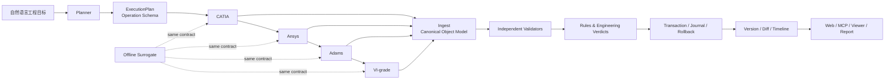

<div align="center">

# SimLoom AI

### 面向车辆与机械研发的跨软件 AI Engineering Agent Runtime

把自然语言工程目标，连接到 CATIA、Ansys、Adams 和 VI-grade 的模型、脚本、
结果、验证与版本历史。

[快速开始](#快速开始) · [离线四软件闭环](#离线四软件闭环) · [能力地图](#能力地图) · [项目定位](#项目定位)

</div>

<div align="center">


</div>

SimLoom AI 是一个离线优先的工程 Agent 原型，面向车辆、底盘、悬架、机构和
机械零件研发。它把四个软件之间容易丢失的上下文统一起来：同一份工程对象、
同一套事务边界、同一套验证规则、同一条版本与审计链。

项目地址：[github.com/MODA255/SimLoom-AI](https://github.com/MODA255/SimLoom-AI)

## 项目定位

SimLoom AI 的核心不是替代某一个 CAD 或仿真软件，而是成为连接工程工具的
AI runtime：

```text
自然语言工程目标
        ↓
AI 任务规划与 operation schema
        ↓
CATIA → Ansys → Adams → VI-grade
        ↓
模型、脚本、STEP、CSV、JSON、结果文件
        ↓
独立几何/结果验证、指标判断、版本 diff、可视化和审计
```

商业软件可以通过 Windows bridge 接入；没有商业软件时，离线 surrogate 会使用
相同的工程对象、事务、验证和报告接口，让团队先验证完整链路，再替换单个软件
执行阶段。

## 能解决什么问题

- 把一个车辆或机械研发目标拆成有依赖关系的 CATIA、Ansys、Adams、VI-grade 任务。
- 从一份 vendor-neutral `ModelSpec` 生成四个软件各自需要的输入和脚本模板。
- 将 STEP、CSV、JSON、DXF、OBJ、SVG、PDF 统一读入工程对象模型。
- 在结果交付前独立检查几何、网格、指标、文件完整性和规则阈值。
- 用事务 staging、锁、journal、checkpoint、commit 和 rollback 管理写操作。
- 创建不可变工程快照，比较版本差异，并生成项目时间线。
- 通过 CLI、Web API、MCP 或 Python API 使用同一套 runtime。

## 能力地图

| 能力 | 当前实现 | 说明 |
| --- | --- | --- |
| AI 规划 | ✅ | 确定性 planner；支持 OpenAI 兼容接口的可选 LLM planner |
| 统一工程对象 | ✅ | 项目、几何、结果、表格、指标和 artifact 归一化 |
| CATIA / Ansys / Adams / VI-grade 脚本生成 | ✅ | 生成可审计的 CATScript、Mechanical Python、Adams command 和 VI-grade scenario 模板 |
| 离线四软件闭环 | ✅ | 无商业软件时生成真实本地 STEP、CSV、JSON 产物并完成规则验证 |
| STEP 读取 | ✅ | 保守实体解析；安装 OCP 后启用真实 B-Rep 检查 |
| B-Rep 几何 | ✅ 可选 | primitive、fuse、cut、common、体积、表面积、拓扑和包围盒 |
| DXF / OBJ | ✅ | 语义实体、图层、块、填充、坐标系、网格读取与独立校验 |
| 结果解析 | ✅ | JSON、CSV 和文本结果；支持指标路径和阈值判断 |
| 事务与恢复 | ✅ | staging、锁、journal、checkpoint、commit、rollback、stale recovery |
| 版本与 diff | ✅ | 不可变快照、字段级差异、资产路径匹配和时间线 |
| Viewer | ✅ | SVG 预览和自包含 WebGL 网格/结果云图 viewer |
| MCP | ✅ | tools、resources、prompts、分页、订阅、schema version 和 error envelope |
| Web 控制台 | ✅ | 规划、任务队列、项目、artifact、资产预览和时间线 API |
| Windows bridge | ✅ 接口 | COM/命令白名单和验收探针；真实软件求解仍需 Windows 授权环境 |

## 架构



所有外部入口最终进入同一套 agent API：

```text
CLI ─┐
Web ─┼─> EngineeringAgent ─> OperationRegistry ─> adapters / validators
MCP ─┘                                      └──> transaction + audit
```

## 快速开始

### 1. 安装

```bash
git clone https://github.com/MODA255/SimLoom-AI.git
cd SimLoom-AI

./install.sh
. .venv/bin/activate
```

项目不要求先安装 CATIA、Ansys、Adams 或 VI-grade。离线 runtime、解析器、验证器、
事务层、MCP 和测试都可以在普通开发环境运行。

### 2. 生成计划

```bash
PYTHONPATH=src python -m engineering_agent.cli plan \
  "用 CATIA 建悬架模型，导入 Adams 做动力学，再用 VI-grade 做操稳分析"
```

### 3. 生成四软件输入

```bash
PYTHONPATH=src python -m engineering_agent.cli \
  --project-dir ./examples/demo_project generate \
  --name suspension_demo
```

生成内容包括：

```text
artifacts/generated/
├── model_spec.json
├── catia/create_model.CATScript
├── ansys/solve.py
├── adams/build_model.cmd
├── vi-grade/scenario.json
├── vi-grade/run_scenario.py
└── README.md
```

### 4. 检查工程资产和指标

```bash
PYTHONPATH=src python -m engineering_agent.cli \
  inspect --root examples/demo_project

PYTHONPATH=src python -m engineering_agent.cli \
  evaluate examples/demo_project/metrics.json \
  examples/demo_project/rules.json
```

## 离线四软件闭环

离线闭环用于验证整个工程 runtime 的行为，不要求商业软件安装。它会依次生成：

1. CATIA 阶段：真实本地 STEP 几何。
2. Ansys 阶段：结构结果 JSON，包括应力、位移和网格质量。
3. Adams 阶段：运动 CSV，包括时间、转向、横摆角速度和侧向加速度。
4. VI-grade 阶段：车辆指标 JSON，包括横摆增益、转向不足梯度和圈速。

运行示例：

```bash
PYTHONPATH=src python -m engineering_agent.cli \
  --project-dir ./examples/offline_demo offline-run \
  --model-spec "$(cat examples/offline_demo/model_spec.json)" \
  --rules examples/offline_demo/rules.json
```

成功后，产物位于：

```text
examples/offline_demo/artifacts/generated/
├── offline/model.step
├── offline/ansys_result.json
├── offline/adams_motion.csv
├── offline/vigrade_metrics.json
└── offline/report.json
```

报告会把 Ansys 和 VI-grade 指标合并后交给独立规则验证器。每个产物都会记录
文件大小和 SHA-256，整个过程经过事务 staging 后一次性提交。

离线阶段是确定性的工程 surrogate，用来验证对象、文件、事务、规则和审计边界。
它不代表 CATIA、Ansys、Adams 或 VI-grade 的真实求解结果；接入 Windows bridge 后，
可以保持报告和验证接口不变，替换相应 stage。

## OpenCascade / STEP B-Rep

安装可选 B-Rep 后端：

```bash
./.venv/bin/python -m pip install -e '.[brep]'
```

可用时，runtime 可以读取 STEP solid，计算体积和表面积，检查拓扑，创建 box/cylinder，
并执行 `fuse`、`cut`、`common`：

```bash
PYTHONPATH=src python -m engineering_agent.cli brep-doctor

PYTHONPATH=src python -m engineering_agent.cli \
  --project-dir ./examples/demo_project \
  brep-primitive box artifacts/box.step \
  --parameters '{"length": 100, "width": 50, "height": 20}'

PYTHONPATH=src python -m engineering_agent.cli \
  brep-inspect artifacts/box.step
```

没有 B-Rep 依赖时，系统会明确返回后端不可用，并保留保守 STEP 实体解析能力。

## Web 控制台与任务队列

启动本地 Web 控制台：

```bash
PYTHONPATH=src python -m engineering_agent.cli serve --port 8787
```

打开 `http://127.0.0.1:8787` 后，可以生成计划、提交任务并查看任务状态。主要接口包括：

现在的首页已经按工程工作台组织：左侧是工程导航，中间是任务输入和 CATIA →
Ansys → Adams → VI-grade 流程画布，右侧区域展示验证指标、任务时间线、资产
扫描和工具诊断。模板卡片可以直接开始悬架结构、悬架动力学、整车操稳或自定义流程。
“运行离线闭环”按钮会调用同一套 runtime，适合第一次试用和没有商业软件的机器。

| 方法 | 路径 | 用途 |
| --- | --- | --- |
| `GET` | `/api/health` | 健康检查 |
| `POST` | `/api/plan` | 生成并校验计划 |
| `GET/POST` | `/api/tasks` | 查询或提交任务 |
| `GET/POST` | `/api/projects` | 管理历史项目 |
| `GET` | `/api/artifacts` | 列出工程产物 |
| `GET` | `/api/asset-view` | 获取 SVG/WebGL 资产预览 |
| `GET` | `/api/timeline` | 获取版本时间线 |
| `GET` | `/api/doctor` | 检查工具配置 |

工作台也提供 `GET /api/templates` 和 `POST /api/offline-run`，方便桌面壳或其他
前端复用模板与离线执行能力。

也可以使用 SQLite 任务队列：

```bash
PYTHONPATH=src python -m engineering_agent.cli enqueue \
  --db engineering-agent.db \
  "用 CATIA 建悬架并做 Adams 动力学"

PYTHONPATH=src python -m engineering_agent.cli worker \
  --db engineering-agent.db --once
```

## MCP 接口

启动 stdio MCP server：

```bash
PYTHONPATH=src python -m engineering_agent.cli mcp --profile full
```

核心工具包括：

- `engineering_plan`：生成并校验跨软件计划。
- `engineering_run`：以 dry-run 或执行模式运行计划。
- `engineering_generate`：生成四软件输入和脚本。
- `engineering_offline_run`：运行无商业软件的四软件闭环。
- `engineering_ingest`：读取 STEP、CSV、JSON 等工程资产。
- `engineering_project`：查看统一工程对象。
- `engineering_version` / `engineering_diff`：创建快照和比较版本。
- `operation.*`：访问类型化 operation schema。

MCP 层支持资源发现、资源模板、分页、订阅、schema version 和统一 error envelope。

## Windows 软件接入

Windows bridge 为真实软件预留了统一入口：

```bash
PYTHONPATH=src python -m engineering_agent.cli windows-validate
PYTHONPATH=src python -m engineering_agent.cli windows-validate --smoke
```

执行真实软件前，需要在授权的 Windows 工作站安装对应软件，并配置：

- 软件可执行文件或 bridge URL。
- CATIA / Ansys / Adams / VI-grade 的项目模板和命名约定。
- pywin32 或厂商 API。
- 输入文件映射、结果字段和工程指标规则。

配置示例见 [`configs/engineering-agent.example.json`](configs/engineering-agent.example.json)。

## Python API

```python
from engineering_agent import EngineeringAgent

agent = EngineeringAgent({"tools": {}})

plan = agent.plan("用 CATIA 建悬架，再用 Adams 做动力学")
print(plan.to_dict())

result = agent.run_offline_vehicle_chain(
    "./examples/offline_demo",
    {"name": "demo_suspension"},
)
print(result["status"])
print(result["report"])
```

## 事务、版本与审计

每次写入都会经过项目事务层：

```text
begin → lock → stage → checkpoint → validate → commit
                                      ↘ fail → rollback
```

运行记录保存在 `artifacts/runs/<run_id>/`，包括：

- `journal.jsonl`：状态转换和操作事件。
- `state.json`：运行状态。
- `stage/`：待提交产物。
- `manifest.json`：已提交文件清单。
- `backup/`：覆盖已有文件时的恢复副本。

版本快照会保留工程对象和来源路径，diff 会忽略临时 object id，并对指标、几何和
资产变化生成字段级结果。

## 测试与验证

在项目根目录运行：

```bash
PYTHONPATH=src ./.venv/bin/python -m pytest -q
```

当前本地全量回归结果：**423 passed**。测试覆盖规划、脚本生成、事务恢复、格式读写、
DXF 语义实体、OBJ 网格、STEP B-Rep、MCP、Web API、版本 diff、Windows 探针和离线
四软件闭环。

## 项目结构

```text
SimLoom-AI/
├── src/engineering_agent/   # Agent runtime、planner、adapter、validator、viewer
├── src/orchestrator/        # 现有任务编排与回归基础设施
├── examples/                # demo project 和 offline four-tool fixture
├── configs/                 # 工具、bridge 和任务配置示例
├── tests/                   # 单元、集成和契约测试
├── ENGINEERING_AGENT.md     # 详细工程能力说明
└── install.sh               # 本地安装脚本
```

## 当前边界与演进方向

当前版本已经可以在没有商业软件的环境中完成端到端 runtime 验证。真实生产接入的
主要工作集中在 Windows 工作站：CATIA 参数化 feature graph、Ansys Mechanical
项目模板、Adams 多体模型、VI-grade 车辆模型、厂商结果字段和团队工程规则。

后续演进方向包括：

- 更完整的 CATIA 参数化特征和装配图谱。
- 更丰富的真实 Ansys / Adams / VI-grade 结果适配器。
- 真实软件执行后的自动回读、校验和失败恢复。
- 面向团队的权限、凭据、远程 Windows worker 和 artifact registry。
- 更完整的交互式 CAD、网格和仿真云图工作区。

## 贡献

欢迎围绕以下方向提交 issue 或 pull request：

- 新的工程文件格式和结果解析器。
- 独立几何/结果验证规则。
- MCP operation schema 和 Windows bridge 适配器。
- 真实软件 fixture、模板和跨软件工程案例。

请保持新增能力可离线测试，并为外部软件调用保留清晰的事务、日志和失败边界。
