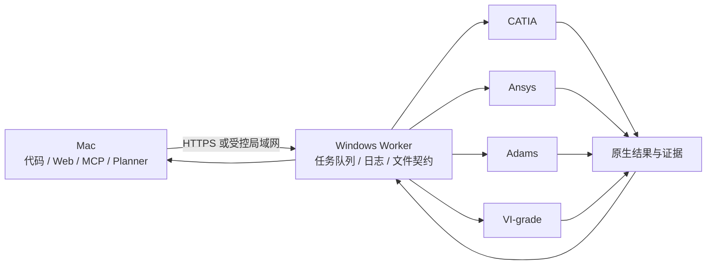

# Mac 开发、Windows 实机联调

SimLoom AI 的推荐部署方式是“Mac 控制端 + Windows 软件工作站”。Mac 继续承载代码、Web
界面、MCP、规划器和离线测试；Windows 只负责在真实的工程师桌面会话里启动 CATIA、Ansys、
Adams 和 VI-grade，等待它们完成，再把原生文件和日志交回 Mac。



这条边界很重要：Mac 不需要安装四款软件，也不需要访问 Windows 路径；Windows worker 不
负责规划任务。两端通过 `simloom-ai/worker/v1` 请求、输出文件清单、SHA-256 和错误契约
通信。项目中已有的 `docs/WINDOWS_WORKER_SETUP.md` 和 `docs/SOFTWARE_INTEGRATION.md`
是详细协议说明，本文件是实际联调时的执行顺序。

## 1. 先准备 Windows 工作站

建议使用一台独立的 x86-64 Windows 工作站，使用固定的工程师账户登录。安装：

- 与项目匹配的 Python、Git 和 SimLoom AI；
- CATIA、Ansys、Adams、VI-grade 的确定版本；
- 对应的许可证客户端、许可证服务器配置和厂商 SDK；
- 四款软件所需的模板、命令文件、结果导出脚本和测试工程。

如果 Mac 是 Apple Silicon，Windows ARM 或虚拟机可以用于早期协议测试，但不能默认当作四款
商业软件的验收环境。许可证、COM、显卡、求解器和厂商插件都应在真实 x86-64 Windows 桌面
会话里验收。条件允许时，优先使用远程物理工作站；也可以使用有 GPU、许可证网络和持久桌面
会话的专用 Windows 虚拟机。

不要把 worker 作为唯一的 Windows 服务运行。服务可以负责监控和拉起进程，但真正操作软件
的 worker 必须运行在已登录的工程师用户会话中，因为 COM、桌面窗口、图形求解器和用户许可证
可能依赖交互式桌面。工作站应关闭自动睡眠，避免同时登录多个会话，并为每款软件准备独立的
项目目录和输出目录。

在 Windows 上获取项目并安装依赖：

```bat
git clone git@github.com:MODA255/MODA255-SimLoom-AI.git C:\SimLoom\SimLoom-AI
cd /d C:\SimLoom\SimLoom-AI
install-windows.cmd
```

将 `configs/engineering-agent.example.json` 复制成工作站专用配置。不要把许可证密码或 bridge
token 提交到 Git；token 通过本机环境变量或只读配置注入。

## 2. 让 Mac 能访问 Windows worker

最简单的联调方式是 Mac 和 Windows 在同一受控局域网或同一 VPN/Tailscale 网络中，Windows
worker 只监听该私网地址。若 Windows 不能被 Mac 入站访问，应使用 VPN 或反向代理；不要为了
省事把 8099 端口直接暴露到公网。

Windows 配置的核心部分如下，动作名必须和控制端一致，命令必须是 argv 数组，并且包含
`{script}` 占位符：

```json
{
  "windows_bridge": {
    "root_dir": "C:/SimLoom/worker",
    "host": "0.0.0.0",
    "port": 8099,
    "token": "由密钥管理器或环境变量提供的长随机值",
    "timeout_seconds": 1800,
    "commands": {
      "catia.create_or_update_model": [
        "C:/SimLoom/.venv/Scripts/python.exe",
        "C:/SimLoom/scripts/catia_runner.py",
        "{script}",
        "{request_file}"
      ],
      "ansys.mesh_and_solve": [
        "C:/SimLoom/.venv/Scripts/python.exe",
        "C:/SimLoom/scripts/ansys_runner.py",
        "{script}",
        "{request_file}"
      ]
    },
    "com": {}
  }
}
```

先只配置一款软件的一个动作，确认网络、认证、作业目录和输出回传都正常后，再逐款增加动作。
Windows 防火墙只放行私网来源；若使用反向 TLS 代理，worker 仍应保留 token 校验。

在已登录的 Windows 桌面启动：

```bat
cd /d C:\SimLoom\SimLoom-AI
.venv\Scripts\engineering-agent.exe --config C:\SimLoom\worker.json bridge --bridge-config C:\SimLoom\worker.json
```

Mac 端配置四个工具的同一个 worker 地址：

```json
{
  "tools": {
    "catia":   {"bridge_url": "http://win-sim-01:8099", "bridge_token_env": "SIMLOOM_BRIDGE_TOKEN"},
    "ansys":   {"bridge_url": "http://win-sim-01:8099", "bridge_token_env": "SIMLOOM_BRIDGE_TOKEN"},
    "adams":   {"bridge_url": "http://win-sim-01:8099", "bridge_token_env": "SIMLOOM_BRIDGE_TOKEN"},
    "vi-grade": {"bridge_url": "http://win-sim-01:8099", "bridge_token_env": "SIMLOOM_BRIDGE_TOKEN"}
  }
}
```

## 3. 从只读检查开始

Mac 先检查 Windows worker，不要一开始就启动求解：

```text
GET http://win-sim-01:8099/health
GET http://win-sim-01:8099/capabilities
```

返回 `reachable` 只表示 worker 可访问，`configured` 只表示动作已配置，`executable_found`
只表示命令能解析。它们都不能证明软件已安装、许可证有效、脚本正确或结果合格。项目中的
`engineering_doctor`、`engineering_preflight(probe=true)` 也遵守这个边界。

建议将以下信息保存到联调记录：Windows 主机名、Windows 用户、SimLoom commit、四款软件
版本、Python 版本、许可证服务器、worker 配置摘要和 `/capabilities` 响应。

## 4. 四款软件逐款做最小 smoke test

必须逐款通过最小闭环，再做跨软件链。每个动作都使用模板副本和独立的 request ID，不能直接
覆盖工程师的原始工程。

| 软件 | 最小闭环 | 必须回传的证据 |
| --- | --- | --- |
| CATIA | 打开 CATPart 副本，修改一个明确命名的参数，保存、关闭、重新打开，导出 STEP | 参数两次读回值、STEP、软件版本、日志和截图 |
| Ansys | 打开模板工程，修改一个明确参数，执行最小求解，读取一个结果值并保存原生结果 | 求解状态、结果值和单位、原生工程文件、日志 |
| Adams | 加载最小模型和 command file，运行短时间仿真，导出 JSON/CSV 指标 | 原始结果、列名与单位、求解日志、指标复算结果 |
| VI-grade | 运行团队维护的基线场景，导出原始结果和指标报告 | 场景版本、原始结果、指标报告、日志和截图 |

项目中的 `examples/vendor_runners/` 已经提供四类 runner 的文件契约和独立校验入口，但
其中的命令、ProgID、模板和结果导出方式必须替换成工作站真实版本。fixture、COM dispatch
成功或“软件进程打开”都不能单独标记为 `real_machine_verified`。

## 5. 再做跨软件链

跨软件链不要依赖共享磁盘路径，按文件契约传递产物。例如：

```text
CATIA 参数化副本
  -> STEP / 参数报告
  -> Ansys 模板工程或导入几何
  -> 网格 / 求解结果
  -> Adams 模型输入或指标文件
  -> VI-grade 场景输入与最终指标
```

实际数据流由项目工程师定义，SimLoom 只传递声明过的输入和输出，并在每一步保存请求、脚本、
输入哈希、输出哈希、stdout、stderr 和结果验证。某一步失败时保留该步目录和日志，按原
request ID 查询或恢复，不要盲目重新提交可能已经启动的求解。

## 6. 远程调试和自动化验收

日常开发仍在 Mac 完成，通过 Git 推送代码；Windows 工作站拉取同一个 commit 后重启 worker。
需要查看代码时可用 VS Code Remote SSH 或 Windows 远程桌面，但四款软件必须留在 Windows
交互式会话中运行。

CI 分成两层：

1. Mac 和公共 CI 跑协议、事务、文件传输、离线 fixture、错误恢复和 Web/MCP 测试。
2. 私有 self-hosted Windows runner 跑真实软件 smoke test，按 `windows-catia`、
   `windows-ansys`、`windows-adams`、`windows-vigrade` 打标签；每款软件独立排队，避免同时
   抢占同一个许可证或桌面会话。

真实 Windows runner 应在测试前记录软件版本和许可证状态，在测试后上传原生文件、日志、
截图、输入输出哈希和独立验证报告。没有这些证据时，结果只能是协议通过或 fixture 通过。

## 7. 常见故障定位

- Mac 访问不到 `/health`：先检查 VPN、Windows 防火墙、监听地址和端口，再检查 token。
- `/health` 成功但动作不可执行：看 `command_checks`、脚本路径、Python 环境和 `{script}`
  占位符；Windows 路径不会在 Mac 上解析。
- COM dispatch 失败：确认 worker 在 Windows 桌面用户会话中运行、pywin32 与 Python 位数匹配、
  软件已安装并允许当前用户启动；dispatch 成功仍不代表工程操作成功。
- 软件打开后任务卡住：在 Windows 桌面检查弹窗、许可证占用、求解器等待和保存对话框；不要
  立即重试同一个 request ID。
- 结果回传失败：检查作业目录中的 stdout/stderr、输出清单、文件大小和 SHA-256；原生输出
  不完整时任务应保持失败并保留现场。
- RDP 断开后软件停止：说明 worker 依赖当前桌面会话。改用保持会话的远程方式，或让工作站
  在工程师用户会话中持续运行，并把自动化测试安排到该会话内。

真正的四软件联调从“Windows worker 可访问”开始，到“每款软件最小闭环通过”，最后才是
“跨软件链和异常恢复通过”。Mac 上可以完成前两层的大部分开发，但不能替代 Windows 上的
许可证、COM、GUI、求解器和原生结果验收。
